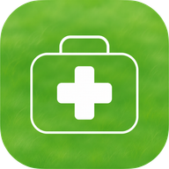
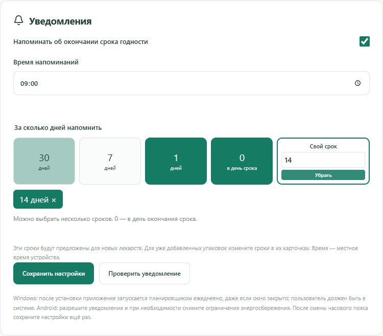
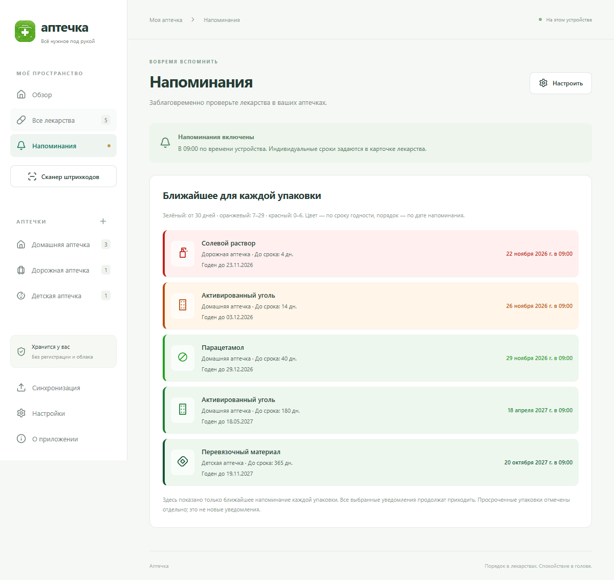
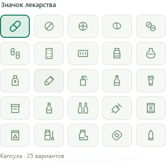

# Аптечка — лекарства и сроки под контролем

**Android и Windows · автор идеи Manuliy**

Сканируйте упаковки, собирайте домашние и дорожные аптечки, выбирайте напоминания и обменивайтесь выбранными аптечками в одной сети.

**[Скачать последнюю версию](https://github.com/TMentosT/aptechka-releases/releases/latest)** · [Все выпуски](https://github.com/TMentosT/aptechka-releases/releases)

## 1. Добавьте упаковку — найдите её в своей аптечке

Нажмите «Добавить»: отсканируйте Data Matrix камерой, выберите фотографию или заполните карточку вручную. На Windows можно использовать сканер штрихкодов в режиме клавиатуры. Проверьте название и срок, выберите аптечку и теги, сохраните.

Одинаковые названия объединяются в раскрываемую группу: видны число пачек и ближайший срок, внутри — каждая упаковка со своими данными. Поиск, фильтры и четыре режима сортировки помогают найти нужное.

## 2. Выберите, когда напомнить

Отметьте несколько кнопок **30, 7, 1, 0** или введите своё число дней и нажмите «Выбрать». Ноль означает день окончания срока. Для каждой упаковки можно задать собственные сроки; в настройках — общие значения для новых упаковок и время уведомлений.

Во вкладке «Напоминания» показывается ближайшее будущее событие каждой упаковки. Все выбранные системные напоминания сохраняются. Ближайшие события находятся сверху. Цвет меняется по оставшемуся сроку: **от 30 дней — зелёный, 29–7 — оранжевый, 6–0 — красный**; просроченные отмечены отдельно.

## 3. Обменивайтесь только выбранными аптечками

**Android ↔ Android без компьютера, Android ↔ Windows, Windows ↔ Windows.** Установите **1.7.0 или новее на оба устройства** и подключите их к одной частной сети.

1. Откройте «Синхронизация» и отметьте нужные аптечки. По умолчанию выбраны текущие аптечки — снимите лишние отметки. Чтобы менять уже общую аптечку, выберите её на обоих устройствах.
2. На первом устройстве нажмите «Открыть приём».
3. На втором отсканируйте QR или вставьте код и нажмите «Подключиться и сравнить».
4. Проверьте изменения, разрешите конфликты и нажмите «Подтвердить синхронизацию» **на обоих устройствах**. Держите приложения открытыми до завершения.

Исключённые аптечки не передаются и не изменяются. Новую выбранную аптечку можно получить после проверки плана. Удалённые аптечки можно выбрать отдельно для передачи удаления. Совпадение упаковок определяется по Data Matrix; независимые ручные записи всегда отдельные. Повторный обмен не создаёт копий уже переданных записей.

Обмен зашифрован, работает напрямую, без внешнего сервера и фонового подключения. Настройки напоминаний остаются индивидуальными; у впервые полученных упаковок их нужно включить. Перед сохранением создаётся локальная копия для восстановления.

## 4. Сделайте аптечку узнаваемой

Выберите **20 значков аптечек** и **25 значков лекарств**: таблетки, капсулы, блистеры, флаконы, капли и другие формы. Значки выбираются при создании или редактировании и сохраняются в резервных копиях и синхронизации.

*На иллюстрациях — демонстрационные записи, а не рекомендации по лечению.*

## Установка и обновления

В разделе Releases выбирайте **Aptechka-X.Y.Z-Windows.exe** для Windows x64 или **Aptechka-X.Y.Z-Android.apk** для Android 7.0 и новее. Установите поверх предыдущей версии; перед обновлением сохраните резервную копию в настройках.

Приложение проверяет GitHub при запуске и во время работы, показывает изменения и кнопку скачивания. Ручная проверка и выключатель находятся в «О приложении». Скачивание открывается в браузере, установку запускает пользователь. Вход в GitHub не нужен; данные аптечек не отправляются при проверке обновлений.

Это личная версия: Windows-установщик без коммерческой цифровой подписи, APK подписана тем же отладочным ключом, что предыдущие выпуски. Работы по iPhone заморожены.

## Полезно знать

- Для автозаполнения полный код упаковки отправляется в сервис «Честного знака». Доступность этого интерфейса не гарантирована; данные можно внести вручную. Фото декодируется на устройстве.
- Для синхронизации нужны частные IPv4-сети. Гостевая сеть, изоляция клиентов или VPN могут мешать соединению; в Windows разрешите частную сеть при запросе брандмауэра. Не публикуйте QR/код подключения.
- Сеанс закрывается при сворачивании или через 10 минут. При обрыве после сохранения на одном устройстве повторите обмен.
- При пересечении с исключённой аптечкой обмен остановится и предложит изменить выбор. У старой истории удалений 1.6.0 может отсутствовать связь с аптечкой: такие удаления не передаются выборочно; попытка вернуть удалённую запись с другого устройства остановит обмен с объяснением.
- Системные ограничения энергосбережения могут задерживать уведомления. Разрешите их и используйте кнопку проверки в настройках.
- Автоматические проверки включают выборочный обмен, два экземпляра Windows и сетевой модуль Android на JVM. Они не заменяют проверку на физических телефонах.
- Теги помогают организовать хранение и не являются рекомендациями по лечению. Источники и лицензии компонентов приведены в «О приложении».

Здесь публикуются установщики, описания, контрольные суммы SHA-256 и иллюстрации. **Исходники приложения и личные данные не публикуются.** Автоматические архивы GitHub «Source code» содержат только README и иллюстрации этого репозитория.
