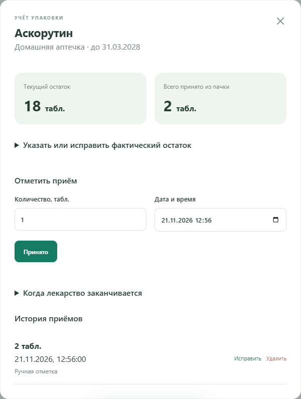
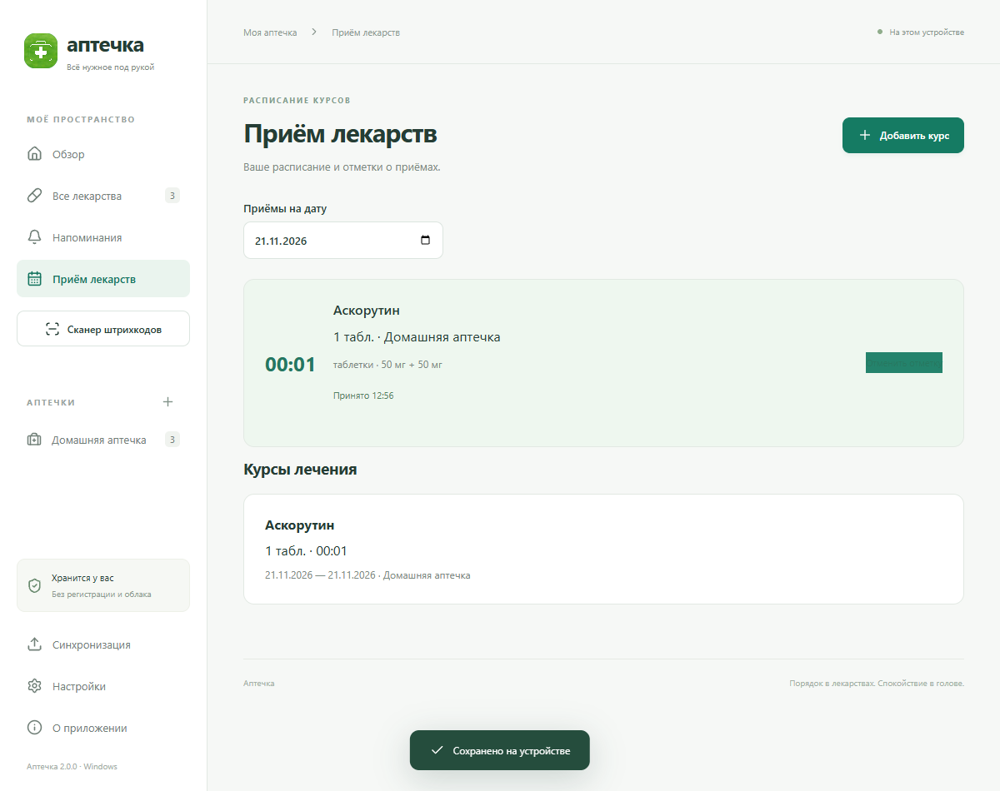
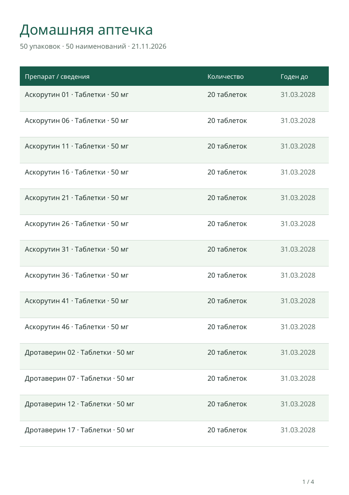
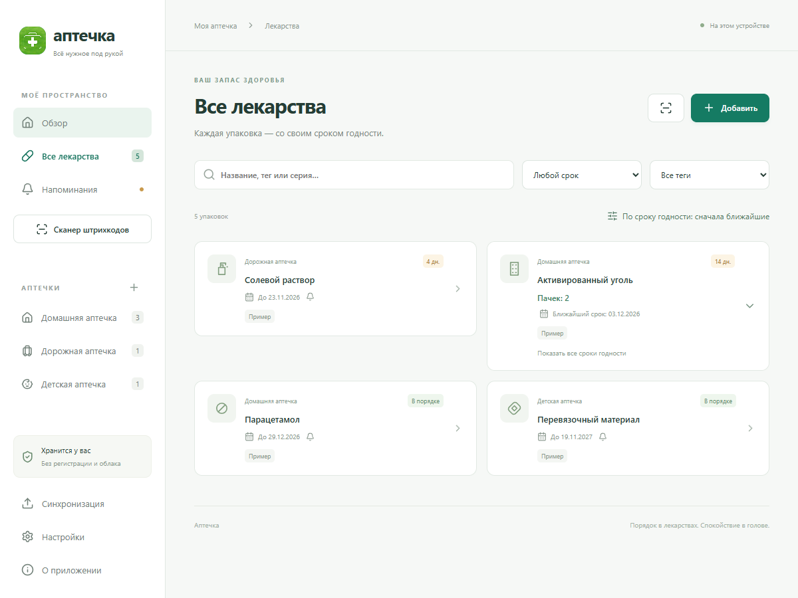
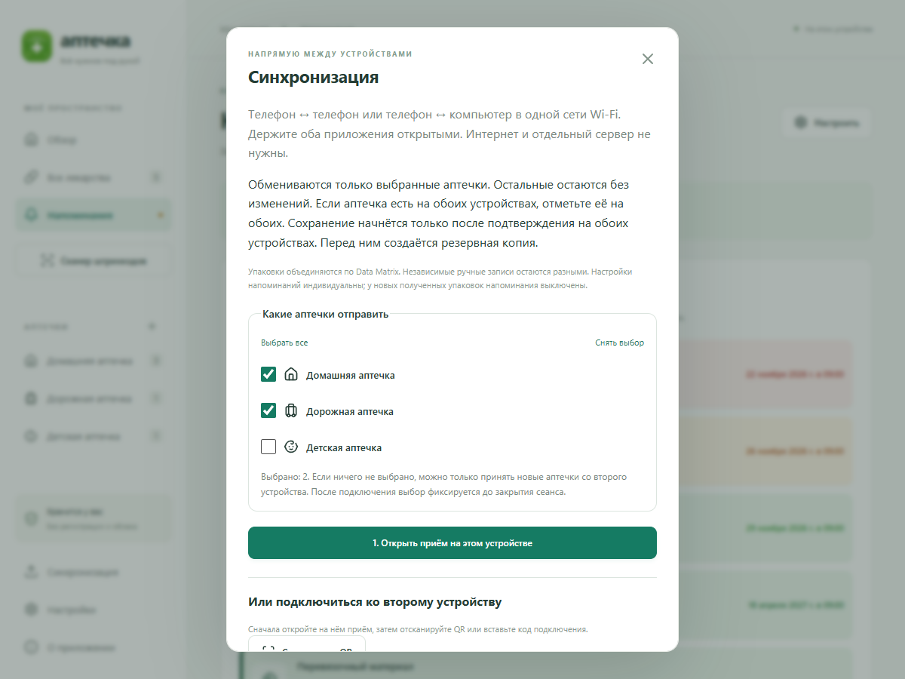

# Аптечка 2.0 — лекарства, остатки и приёмы

**Android и Windows · автор идеи Manuliy**

Сканируйте упаковки, ведите домашние и дорожные аптечки, следите за остатками и курсами лечения. Печатайте компактный список содержимого и передавайте выбранные аптечки между своими устройствами в одной сети.

**[Скачать последнюю версию](https://github.com/TMentosT/aptechka-releases/releases/latest)** · [Все выпуски и изменения](https://github.com/TMentosT/aptechka-releases/releases)

| Возможность | Как помогает |
|---|---|
| Data Matrix | Название, срок и доступные характеристики по коду конкретной упаковки; камера, фото, ручной ввод и USB/HID-сканер в Windows |
| Аптечки и группы | Разные места хранения, значки, теги, поиск, сортировка; пачки с одинаковым названием раскрываются в одном блоке |
| Остатки | Отдельное окно количества, приёмы, исправления и отмены; функция включается по желанию |
| Курсы лечения | Расписание, уведомления, отметка «Принято», списание из ближайших непросроченных пачек выбранной аптечки |
| Бумажный список | Цветная компактная таблица A5 либо готовый буклет A4, выбор столбцов, сортировка, предпросмотр и печать |
| Прямой обмен | Android ↔ Android и Android ↔ Windows; выбранные аптечки, без аккаунта и сервера, с подтверждением на обоих устройствах |

## Остаток и история — отдельным окном

1. Откройте **Настройки → Учитывать остатки в упаковках**, сохраните настройку.
2. На карточке нажмите **Остаток и приёмы**. Задайте фактическое количество и единицу: таблетки, капсулы, миллилитры, капли, штуки или граммы.
3. Введите количество и нажмите **Принято**. Остаток и общий расход пересчитаются.
4. **Показывать историю приёмов** включается отдельно. У ручной записи можно исправить дату и количество либо удалить ошибочный приём. Удаление сохраняется как отмена для корректной синхронизации.
5. В этом же окне раскройте **Когда лекарство заканчивается** и задайте минимальный остаток. Порог общий для одинакового названия внутри одной аптечки. Запас в другой аптечке не скрывает нехватку. Включите отдельный переключатель уведомлений о низком остатке.

Если учёт выключен, кнопка скрыта и новые списания не выполняются; старые данные сохраняются. При выключенной истории новые приёмы учитываются в остатке и общем расходе, но не показываются в журнале. Для суммирования все пачки группы должны иметь известный остаток и одинаковую единицу.

## Курсы лечения

Во вкладке **Приём лекарств → Добавить курс** выберите аптечку, препарат нужной формы и дозировки, количество за один приём, даты, время и дни недели. Уведомления о курсах включаются отдельно в настройках. Курс можно приостановить переключателем **Курс активен**.

Нажатие уведомления открывает вкладку приёмов. Если нужна отметка, можно включить **один повтор через N минут** (от 5 до 1440; 0 — без повтора). Повтор не переносится за следующий приём этого дня или за полночь. Кнопка **Принято** доступна после времени в расписании; автоматического списания без отметки нет.

При включённом учёте приложение использует непросроченные пачки выбранной аптечки с совпадающими действующим веществом, формой, дозировкой и единицей. Сначала расходуется пачка с ближайшим сроком; если её мало, списание продолжается из следующей. При нехватке отметка не сохраняется. **Отменить отметку** возвращает количество в исходные пачки.

Курсы, остатки, приёмы и отмены передаются при синхронизации. Один запланированный приём не списывается дважды. Если оба устройства независимо изменили одну отметку, перед обменом нужно выбрать вариант. До следующей ручной синхронизации второе устройство может продолжать напоминать о уже отмеченном на первом приёме.

## Компактный список в аптечку

Откройте нужную аптечку → **Выгрузить PDF**. Выберите поля, сортировку и формат, затем нажмите **Предварительный просмотр**. После просмотра доступны **Сохранить PDF**, **Печать**, а на Android — **Поделиться**.

Все поля выбираются отдельно: название, действующее вещество, форма, дозировка, количество в упаковке, остаток при включённом учёте, срок годности, серия, теги, заметки. По умолчанию сортировка по алфавиту, без срока годности. Каждая строка — отдельная упаковка; длинные сведения переносятся без обрезки. Заголовок аптечки только на первой странице; можно включить отдельную обложку. Настройки сохраняются для каждой аптечки и синхронизируются вместе с ней.

На демонстрационном наборе **50 препаратов помещаются на 4 страницы A5**. Число страниц зависит от выбранных полей и длины заметок.

- **A5** — страницы обычного документа.
- **Буклет A4** — развороты уже расставлены для складывания. Печатайте горизонтально, с двухсторонней печатью и переворотом по короткому краю. Повторно включать режим «буклет» в принтере не нужно. Приложение добавляет пустые страницы до числа, кратного четырём.
- Цветные полосы помогают читать таблицу; текст остаётся понятным при чёрно-белой печати. Для печати с телефона нужна доступная служба печати Android.

## Начало работы

1. Установите Windows-файл `.exe` или Android-файл `.apk` из Releases. Для APK разрешите установку из выбранного источника, если телефон попросит.
2. Создайте аптечки. Для каждой можно выбрать один из 20 значков; для лекарства — один из 25.
3. Сканируйте Data Matrix либо нажмите **Добавить**. Доступны фото и вставка полного кода. В Windows кнопка **Сканер штрихкодов** принимает ввод сканера в режиме HID-клавиатуры; COM/Serial не поддерживается.
4. Проверьте сведения по упаковке. Ручной ввод предлагает похожие названия из вашей аптечки, чтобы избежать опечаток.
5. Выберите предложенные теги или введите свои. В версии 2.0 сначала идут понятные категории, затем характеристики. Например, при заполненном составе Аскорутина предлагаются «Сосудистые», «Капилляры», «Витамины», «Таблетки». По одному торговому названию назначение не угадывается.
6. Включите нужные уведомления в настройках. Для сроков годности можно выбрать несколько кнопок 30, 7, 1, 0 и добавить собственное число дней.

Во вкладке **Напоминания** показано ближайшее событие для каждой упаковки, сверху — ближайшие. Цвет меняется по сроку: зелёный, оранжевый, красный. Нажмите подпись сортировки в каталоге, чтобы выбрать А–Я, Я–А или порядок сроков. Одинаковые названия группируются независимо от заполнения дополнительных характеристик.

## Синхронизация без сервера

1. Обновите **оба устройства до 2.0.0** и подключите их к одной обычной Wi-Fi/локальной сети.
2. На каждом откройте **Синхронизация** и отметьте аптечки, которые хотите передать. Невыбранные аптечки не передаются.
3. На первом нажмите **Открыть приём**. На втором отсканируйте QR-код подключения или вставьте код.
4. Просмотрите изменения, при необходимости разрешите конфликты и **подтвердите обмен на обоих устройствах**.

Обмен зашифрован и выполняется только по кнопке; автоматической синхронизации нет. Data Matrix определяет тождество упаковки. Независимо созданные вручную записи остаются разными; повторный обмен уже полученными записями их не размножает. Перед обменом сохраняется локальная копия. Переключатели уведомлений и учёта настраиваются отдельно на каждом устройстве.

Гостевая сеть, VPN и изоляция клиентов роутера могут мешать связи. В Windows разрешите приложению доступ к частной сети. iPhone-проект пока заморожен.

## Обновления, резервные копии и ограничения

Приложение проверяет GitHub и показывает новую версию, описание изменений и кнопку скачивания. Ручная проверка доступна в **О приложении**. Установщик запускаете вы; скрытой установки нет.

Перед обновлением сохраните **Настройки → Резервная копия → Экспортировать**. Устанавливайте поверх предыдущей версии, не удаляя приложение. Android 2.0 подписан тем же ключом, номер сборки повышен. Если ярлык ещё показывает старую картинку, уберите только ярлык с домашнего экрана и добавьте его заново из списка приложений; данные удалять не нужно.

- Это личная сборка: Windows без коммерческой цифровой подписи, Android с прежней тестовой подписью; публикации в магазинах нет.
- Упаковки, связанные с журналом списаний, сохраняются даже после расходования: удаление, смена кода или перенос такой пачки блокируются, чтобы отмена могла вернуть остаток правильно. Аптечку с учётом или курсами также нельзя удалить. Фактический остаток можно исправить.
- При объединении разных приёмов, приводящих к отрицательному остатку, обмен останавливается: исправьте ошибочную запись или фактический остаток на исходном устройстве и повторите.
- Windows проверяет курсы примерно раз в минуту через пользовательский Планировщик заданий, даже при закрытом окне; нужен вход в систему. Во время сна устройства уведомления не доставляются. Android может задерживать уведомления из-за энергосбережения; разрешите их и обновляйте Android System WebView. Одновременно планируется не более 450 уведомлений; при превышении приложение показывает предупреждение.
- Данные хранятся на устройствах. При автозаполнении «Честный знак» получает код упаковки; фото остаётся на устройстве. Недокументированный сервис может быть недоступен — тогда сведения можно внести вручную.
- Теги — категории хранения, а не рекомендации по лечению. Источники классификации и лицензии компонентов, включая шрифт PDF, указаны в **О приложении**.

Все иллюстрации демонстрационные и не содержат личных аптечек. В этом публичном репозитории размещены только инструкция, иллюстрации и выпуски; исходники приложения остаются приватными. Автоматические ZIP «Source code» на странице Release содержат файлы этого репозитория, а не исходный код приложения.
